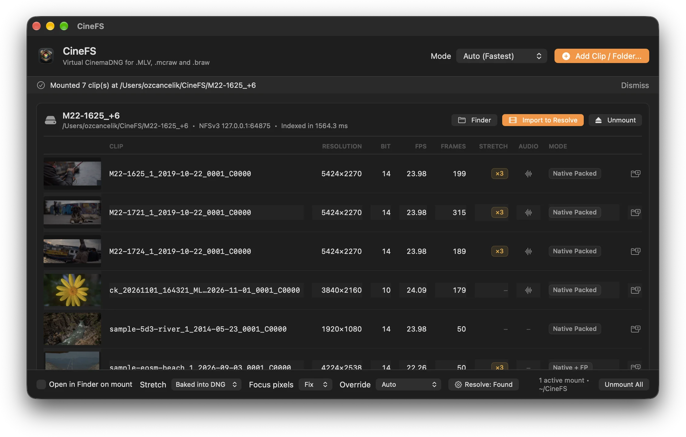
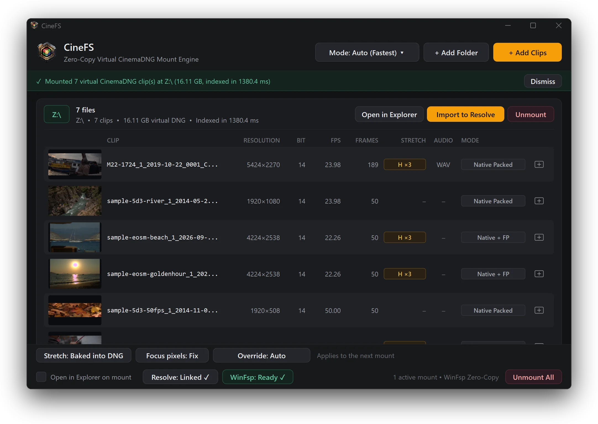

<h1 align="center">
  <picture>
    <source media="(prefers-color-scheme: dark)" srcset="docs/readme-logo-light.png">
    
  </picture>
</h1>

**CineFS** is a high-performance, zero-conversion virtual filesystem that mounts raw video containers (`.MLV`, `.mcraw` and, experimentally, `.braw`) as virtual **CinemaDNG** folders ready to open directly in DaVinci Resolve, Adobe Premiere Pro, and After Effects.

No conversion step and no extra disk space: the CinemaDNG frames are generated on the fly while
your editing software reads them. Your original clips are never modified (the only files CineFS
writes are Adobe `.xmp` sidecars, next to the clip, when you change settings in Camera Raw).

<p align="center">
  
  
</p>

> **Status:** early release (v0.x). Bug reports are very welcome: please
> [open an issue](https://github.com/ozcancelik/CineFS/issues) and, if you can, include a link to a
> short sample clip.

## Download & install

Get the latest version from the [Releases page](https://github.com/ozcancelik/CineFS/releases/latest).

| Platform | File | Notes |
|---|---|---|
| macOS 13 Ventura or later (Apple Silicon and Intel) | `CineFS.dmg` | Open the DMG and drag **CineFS** into **Applications**. Signed and notarized by Apple. |
| Windows 10 / 11, 64-bit | `CineFS-Setup.exe` | Installer. Also installs the [WinFsp](https://winfsp.dev) filesystem driver if it is missing, and can add a "Mount with CineFS" right-click entry. Uninstall from Settings → Apps. |
| Windows 10 / 11, 64-bit | `CineFS-Portable.exe` | No installation; run it from anywhere. Installs WinFsp on first use if needed (asks for administrator permission). |

**Windows SmartScreen:** the Windows builds are not code-signed yet, so Windows may show
"Windows protected your PC" the first time. Click **More info → Run anyway**. Code signing is planned.

**macOS:** no kernel extension, no macFUSE and no administrator password are needed; CineFS
mounts through the NFS client that is built into macOS.

## Using CineFS

1. Open CineFS and drop a clip, several clips, or a folder of clips onto its window
   (on Windows you can also right-click a clip or folder → **Mount with CineFS**).
2. CineFS mounts a virtual volume (macOS) or drive letter such as `Z:` (Windows) containing one
   CinemaDNG folder per clip, plus a `.wav` file when the clip has audio.
3. Import those folders into DaVinci Resolve, Premiere Pro or After Effects like any CinemaDNG footage.
4. Keep CineFS running while you edit; unmount from CineFS when you are done.

## Known limitations

- **Magic Lantern `.MLV`:** there is no dual ISO processing, vertical stripe correction or
  bad/hot pixel correction yet.
- **Focus pixel correction** is applied to Canon bodies with phase-detect pixels in raw video
  (100D, 650D, 700D, EOS M, EOS M2). In `Auto` mode CineFS uses bundled Magic Lantern focus-pixel
  maps first and falls back to learning the lattice from the clip itself for unmapped readout modes
  (where very short or heavily textured clips may leave a few focus pixels uncorrected).
- **Blackmagic RAW `.braw` is experimental.** Black/white levels are approximated, white balance
  is estimated from the first frame (the camera's Kelvin/tint is not used) and the sensor is
  assumed to be Blackmagic Wide Gamut Gen4/5, so colour may not match Blackmagic's own software.

## Background

CineFS is inspired by [MLVFS](https://github.com/davidmilligan/MLVFS), which first showed how good it is
to mount Magic Lantern clips as CinemaDNG folders instead of converting them. CineFS is an independent
re-implementation (it shares no code with MLVFS) that builds on the same idea: native on both macOS and
Windows with nothing extra to install, a desktop app with clip previews, playback and one-click Resolve
import, and support for MotionCam `.mcraw` and (experimentally) Blackmagic RAW `.braw` as well as `.MLV`.

## Highlights

- **O(1) Frame & Metadata Indexing**: Single-pass container indexing at open time; no `.IDX` linear scanning or repeated file open/close overhead.
- **Header / Payload Separation**: Reading DNG TIFF/EXIF headers (for OS thumbnails or NLE media scanning) never triggers pixel decoding.
- **Zero-Decode LJ92 Passthrough**: Lossless JPEG (LJ92) frames in `.MLV` containers that match DNG's 2-component CFA predictor-1 layout are wrapped directly as `Compression = 7` DNG strips without decoding or re-encoding pixels.
- **Zero-Unpack Native Bit Depth**: Uncompressed 8/10/12/14/16-bit `.MLV` frames are served at their native bit depth without inflating to 16-bit.
- **Native MotionCam `.mcraw` Support**: Pure-Rust MotionCam container v3 parser and block-level bitplane decoder (`compressionType = 7` and legacy `6`), mapping dual-illuminant `ColorMatrix1/2`, `ForwardMatrix1/2`, `AsShotNeutral`, dynamic black/white levels, and audio packets directly into virtual CinemaDNG + BWF WAV.
- **Experimental Blackmagic RAW `.braw` Support**: Independent, pure-Rust reader for `.braw` clips that decodes frames to 12-bit Bayer and serves them as virtual CinemaDNG (see [Known limitations](#known-limitations)). See [Trademarks & affiliation](#trademarks--affiliation).
- **Broadcast WAV (BWF) Audio**: `WAVI` + `AUDF` (and `.mcraw` `AUDIO_DATA`) blocks are presented as a virtual `.wav` file with embedded `bext` and `iXML` timecode chunks so DaVinci Resolve automatically syncs audio to the CinemaDNG sequence.
- **Zero-Extension macOS Mount**: Built-in user-space NFSv3 + MOUNTv3 server (`crates/cinefs-core/src/nfs.rs`) mounts virtual CinemaDNG volumes natively via `/sbin/mount_nfs` — no `macFUSE`, no kernel extensions (`kext`), no recovery mode, and no `sudo` required.
- **Zero-Dependency Windows WinFsp Adapter**: Built-in WinFsp C ABI dispatcher (`crates/cinefs-core/src/winfsp.rs`) dynamically loads `winfsp-x64.dll` / `winfsp-a64.dll` at runtime and mounts virtual CinemaDNG volumes to drive letters (`Z:`, `Y:`) or folders.
- **Adobe Premiere Pro & After Effects Compatible**: Full DNG 1.4 tag set (`DefaultCropSize`, `ActiveArea`, `DNGBackwardVersion`, `ForwardMatrix1/2`) plus a hybrid write overlay that persists Adobe Camera Raw `.xmp` sidecar settings next to the source clip while keeping `.pek`/`.DS_Store` temporary files in RAM.

## Command line (`cinefs-cli`)

The command-line tool ships with both apps: on macOS at
`/Applications/CineFS.app/Contents/MacOS/cinefs-cli`, on Windows as `cinefs-cli.exe` next to
`CineFS.exe` (installer version). It works with `.MLV`, `.mcraw` and `.braw` files.

```bash
# Mount a clip, or a folder of clips, as virtual CinemaDNG folders (and open the mount)
cinefs-cli mount path/to/clips_dir ~/CineFS/MyShoot --open
cinefs-cli unmount ~/CineFS/MyShoot

# Inspect a clip / list the virtual files it would produce
cinefs-cli info path/to/clip.MLV
cinefs-cli ls path/to/clip.MLV

# Export a clip to a real CinemaDNG folder on disk
cinefs-cli export path/to/clip.MLV ./out_dir

# Benchmarks: virtual DNG stat / header / full-frame reads, and live-mount playback throughput
cinefs-cli bench path/to/clip.MLV
cinefs-cli mount-bench path/to/clip.MLV

# Diagnostics: look for focus (PDAF) pixels in a clip (experimental)
cinefs-cli focus-probe path/to/clip.MLV ./probe_out
```

`--mode auto|passthrough|packed|unpacked16` chooses how frames are stored in the DNGs
(default `auto`); `mount` also takes `--cache-mb N`, and `export` / `focus-probe` take `--frames N`.
Run `cinefs-cli` without arguments for the full usage.

## Building from source

You need a recent stable [Rust](https://rustup.rs) toolchain.

```bash
cargo test --workspace                     # run the tests
cargo run --release -p cinefs-cli -- info path/to/clip.MLV
```

### macOS app (`CineFS.app` + `CineFS.dmg`)

Requires Xcode (or the Command Line Tools) and both Rust macOS targets:

```bash
rustup target add aarch64-apple-darwin x86_64-apple-darwin
./macos/build_app.sh                        # universal app (Apple Silicon + Intel), macOS 13+
MACOS_ARCHS=arm64 ./macos/build_app.sh      # quicker: Apple Silicon only
open macos/build/CineFS.app
```

The script signs ad-hoc by default, which is fine on your own Mac. Release builds are signed with a
Developer ID and notarized when `CODESIGN_IDENTITY` and `NOTARY_KEY_PATH` / `NOTARY_KEY_ID` /
`NOTARY_ISSUER_ID` are set (see the comments in `macos/build_app.sh`).

### Windows app (`CineFS.exe` + `CineFS-Setup.exe`)

```powershell
powershell -ExecutionPolicy Bypass -File .\windows\build_windows.ps1
```

The script downloads the WinFsp installer (it is embedded in `CineFS.exe`) and, when
[Inno Setup 6](https://jrsoftware.org/isinfo.php) is installed, builds the `CineFS-Setup.exe` installer.

### Releases

CI (`.github/workflows/ci.yml`) runs the tests on every push. Pushing a version tag such as `v0.2.0`
builds both platforms (signing and notarizing the macOS app) and creates a draft GitHub Release. The version must
first be updated in `Cargo.toml`, `macos/CineFS/Info.plist` and `windows/CineFS.iss`;
`scripts/check_version.sh v0.2.0` checks that they agree.

## Workspace layout

- `crates/cinefs-core` — Format parsers (`.MLV` + multi-part `.M00`.., MotionCam `.mcraw`, experimental `.braw`), LJ92 inspector/decoder, bit unpacker/packer, DNG template engine, BWF WAV virtual stream, LRU cache with single-flight deduplication and read-ahead prefetching, user-space NFSv3 server, Windows WinFsp adapter, and C FFI bridge.
- `crates/cinefs-player` — GPU clip player used by both apps: parallel frame decoding, GPU debayer and colour (wgpu: Metal on macOS, Direct3D 12 on Windows), audio-clocked playback (cpal).
- `crates/cinefs-cli` — Cross-platform command-line utility (see above).
- `crates/cinefs-win` — Native Windows Desktop + System Tray application (`CineFS.exe`) with drag-and-drop, automatic drive-letter mounting, built-in player, and one-click DaVinci Resolve `fuscript.exe` Media Pool integration.
- `macos/CineFS` — Native SwiftUI macOS Menu Bar + Desktop application (`CineFS.app`), linking the Rust code as a static library (`libcinefs_player.a`).
- `windows/` — Windows icon (`AppIcon.ico`), Inno Setup installer script (`CineFS.iss`), and PowerShell build script (`build_windows.ps1`).
- `scripts/` — Release helpers (`check_version.sh`).

## Code signing policy

Windows releases (`CineFS-Setup.exe` and `CineFS-Portable.exe`) will be signed through SignPath.

Free code signing provided by [SignPath.io](https://about.signpath.io), certificate by [SignPath Foundation](https://signpath.org).

Only binaries built by this repository's GitHub Actions workflow from the public source code are signed.
Bundled third-party components keep their original publisher's signature (for example the WinFsp
installer, signed by its own maintainer) and are not re-signed by this project.

**Team roles**

- Committers and reviewers: [Özcan Çelik](https://github.com/ozcancelik)
- Approvers: [Özcan Çelik](https://github.com/ozcancelik)

All changes from outside contributors (pull requests) are reviewed by a committer before they are
merged. Every signed release is approved by hand.

**Privacy policy**

This program will not transfer any information to other networked systems unless specifically
requested by the user or the person installing or operating it.

The macOS app runs a small NFS server bound to the local machine (`127.0.0.1`) so that Finder can
mount the virtual folders. It does not accept connections from other computers and sends no data
over the network.

## License

CineFS is free and open source. Anyone may use, modify, redistribute and build on it, for personal
or commercial work, with no strings attached beyond keeping the copyright notice.

Licensed under either of [MIT](LICENSE-MIT) or [Apache-2.0](LICENSE-APACHE) at your option.

### Acknowledgements

CineFS is a bridge tool; the hard work of understanding Magic Lantern RAW video was done by others.
Thanks to the Magic Lantern team and community (the MLV format and `mlv_dump`),
[MLVFS](https://github.com/davidmilligan/MLVFS) (the original idea behind CineFS), MLV App and
MotionCam, whose public documentation and behaviour guided this project. The experimental `.braw`
decoder relies on the bitstream tables and scan orders reverse-engineered by Paul B Mahol for
FFmpeg's (unmerged) `braw` decoder.

### Third-party components

The Windows builds include the unmodified installer of **WinFsp - Windows File System Proxy,
Copyright (C) Bill Zissimopoulos** (<https://github.com/winfsp/winfsp>), redistributed under the
FLOSS exception of its GPLv3 license. The website uses the Geist fonts under the SIL Open Font
License 1.1. See [THIRD_PARTY_NOTICES.md](THIRD_PARTY_NOTICES.md) for details.

### Trademarks & affiliation

CineFS is an independent project. It is **not affiliated with, endorsed by, or sponsored by
Blackmagic Design Pty. Ltd.**, and it does not use or include the Blackmagic RAW SDK. Blackmagic RAW
and DaVinci Resolve are trademarks of Blackmagic Design. Adobe, Premiere Pro and After Effects are
trademarks of Adobe Inc. Other names are trademarks of their respective owners and are used only to
describe compatibility.

### Contributing: keep the licence clean

Raw corrections (focus pixels, bad pixels, stripe fixes, ...) are re-implemented from the published
behaviour of those tools. Please **do not copy source code or data files from GPL-licensed projects**
into this repository: doing so would force the whole project to become GPL and defeat the goal of it
being usable by anyone. Describe the algorithm, then write it independently.
